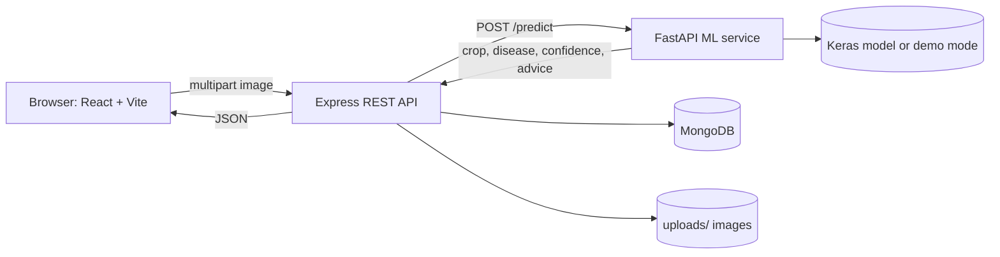

# KhetScan: Plant Disease Prediction App

Upload a photo of a crop leaf and get a likely disease, a confidence score, and treatment and prevention guidance. React frontend, Express API with MongoDB, and a separate FastAPI + TensorFlow/Keras inference service.

> **Status of the AI model:** this repository ships a complete training pipeline but **no trained model and no accuracy claim**. Until you train one, the app runs in **demo mode**, which returns simulated predictions so the whole flow can be tested. Never use demo results to treat a crop.


*(Screenshot placeholders: add images under `docs/screenshots/`.)*

## Features

- Drag-and-drop or browse upload, preview, remove; JPG/PNG with size validation
- Staged analysis progress, then a result card: crop, disease, confidence, status, top predictions, symptoms, treatment, prevention
- History with search, status filter, sorting, pagination, details page and delete
- Dashboard: totals, average confidence, 14-day activity, disease distribution, recent scans
- Knowledge base for 6 crops and 12 diseases (plus healthy classes), unknown classes get a safe generic entry
- Friendly error states for bad images, offline backend, ML or database outages, invalid IDs
- Docker Compose for the whole stack

## Tech stack

React 18, Vite, Tailwind CSS, React Router, Axios, Recharts, Lucide · Node 20+, Express, Mongoose, Multer, Helmet, rate limiting · Python 3.12, FastAPI, TensorFlow/Keras (MobileNetV2 transfer learning), OpenCV, Pillow, NumPy · MongoDB 7

## Architecture



## Folder structure

```text
backend/      Express API (config, controllers, middleware, models, routes, services, utils, tests)
frontend/     React app (components, pages, services, utils, tests)
ml-service/   FastAPI app, disease knowledge base, training scripts, tests
docker-compose.yml
```

## Local setup

Requirements: Node 20+, Python 3.10+, MongoDB (or use `STORAGE_MODE=memory`).

```bash
# 1. ML service (demo mode by default)
cd ml-service && python -m venv .venv && source .venv/bin/activate
pip install -r requirements.txt
uvicorn app.main:app --port 8000

# 2. Backend
cd backend && cp .env.example .env && npm install && npm run dev

# 3. Frontend
cd frontend && npm install && npm run dev      # http://localhost:5173
```

No MongoDB installed? Set `STORAGE_MODE=memory` in `backend/.env` (data is lost on restart).

## Environment variables

| Service | Variable | Default | Purpose |
| --- | --- | --- | --- |
| backend | `PORT` | `5000` | API port |
| backend | `STORAGE_MODE` | `mongo` | `mongo` or `memory` |
| backend | `MONGODB_URI` | `mongodb://localhost:27017/plant_disease` | Database |
| backend | `ML_SERVICE_URL` | `http://localhost:8000` | Inference service |
| backend | `ML_TIMEOUT_MS` | `30000` | Inference timeout |
| backend | `MAX_FILE_MB` | `10` | Upload limit |
| backend | `CORS_ORIGINS` | `http://localhost:5173` | Allowed origins, comma-separated |
| ml-service | `ML_MODE` | `demo` | `demo`, `production` or `auto` |
| ml-service | `MODEL_PATH` | `models/plant_disease_model.keras` | Keras model |
| ml-service | `CLASS_NAMES_PATH` | `models/class_names.json` | Class order from training |

## Docker

```bash
docker compose up --build
# app: http://localhost:8080   api: http://localhost:5000/api/health   ml: http://localhost:8000/health
```

The ML container bakes in whatever is in `ml-service/models/`. Set `ML_MODE=auto` before `docker compose up` to use a trained model.

## Demo and production modes

- **Demo** (`ML_MODE=demo`): simulated, repeatable predictions. The API stores `simulated: true` and the UI shows a warning on every demo result.
- **Production** (`ML_MODE=production`): needs a trained model, otherwise `/predict` returns 503 and `/health` reports `degraded`.
- **Auto** (`ML_MODE=auto`): real model when the files exist, demo otherwise.

## Dataset and training

Download PlantVillage, place it at `ml-service/data/plantvillage/<Crop___Condition>/`, then follow [ml-service/training/README.md](ml-service/training/README.md). Training writes `models/metrics.json` with the validation accuracy it measured. Quote only that number.

## API

All responses are `{ "success": true, "data": ... }` or `{ "success": false, "error": { "code", "message" } }`.

| Method | Path | Notes |
| --- | --- | --- |
| GET | `/api/health` | API, storage and ML status |
| POST | `/api/predictions` | multipart field `image` (JPG/PNG). 201 with the saved prediction |
| GET | `/api/predictions` | `page`, `limit` (1-50), `search`, `status` (`healthy`/`diseased`), `sort` (`newest`, `oldest`, `confidence_desc`, `confidence_asc`). Includes `pagination` |
| GET | `/api/predictions/stats` | Totals, distribution, activity, recent |
| GET | `/api/predictions/:id` | 400 for a malformed ID, 404 if missing |
| DELETE | `/api/predictions/:id` | Removes the record and its image |

Error codes: `NO_FILE`, `UNSUPPORTED_FILE_TYPE` (415), `FILE_TOO_LARGE` (413), `INVALID_IMAGE` (422), `INVALID_ID`, `PREDICTION_NOT_FOUND`, `ML_SERVICE_UNAVAILABLE` (503), `MODEL_UNAVAILABLE` (503), `DATABASE_UNAVAILABLE` (503), `RATE_LIMITED` (429).

## Security

Uploads are checked by MIME type and by file signature, stored under server-generated names, size-limited and rate-limited. Helmet and CORS allow-lists are on, IDs are validated before queries, search input is regex-escaped, and errors never include stack traces. Secrets live in `.env` (git-ignored).

## Testing

```bash
cd backend && npm test        # Jest + Supertest, in-memory storage, mocked ML service
cd ml-service && pytest       # preprocessing, /health, /predict
cd frontend && npm test       # Vitest + Testing Library
```

## Limitations

- No trained model is included, so real predictions require your own training run.
- PlantVillage photos are lab-style (plain background); accuracy on field photos is usually lower.
- Only one leaf and one disease per image; multiple diseases are not detected.
- Treatment text is general guidance and not a substitute for an agronomist.
- No user accounts: all scans are shared per deployment.

## Future improvements

User accounts, field-photo fine-tuning, Grad-CAM explanations, Hindi and regional-language UI, offline PWA, model versioning.
